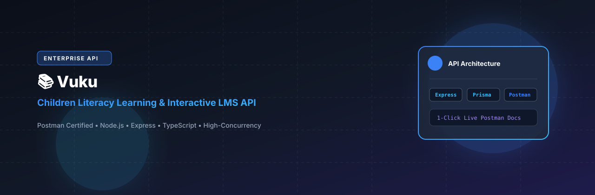
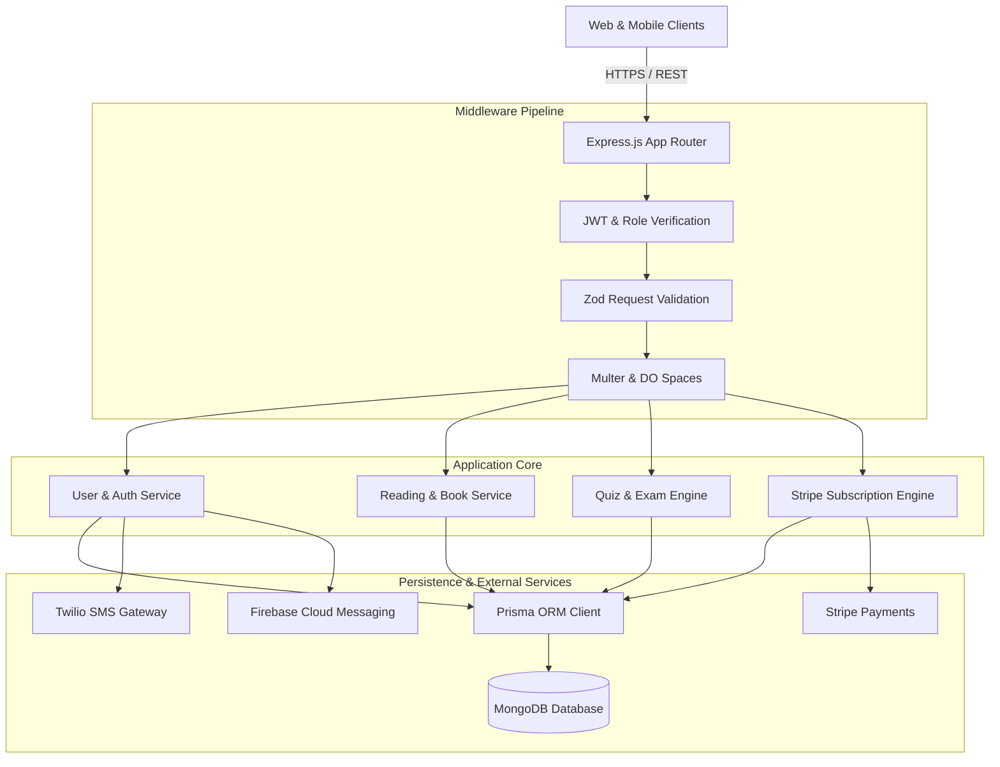

# Ashlyn Prashad Backend (Vuku Reading & Learning API)

<p align="center">
  
</p>

<p align="center">
  <a href="https://nodejs.org"></a>
  <a href="https://expressjs.com"></a>
  <a href="https://www.typescriptlang.org"></a>
  <a href="https://www.prisma.io"></a>
  <a href="https://www.mongodb.com"></a>
  <a href="https://stripe.com"></a>
  <a href="https://firebase.google.com"></a>
  <a href="LICENSE"></a>
</p>

---

## 📖 Overview

**Ashlyn Prashad Backend (Vuku API)** is a robust microservices-ready RESTful backend built with Express.js, TypeScript, and Prisma ORM with MongoDB. Designed for scalable e-learning and interactive reading platforms, the API manages reading progress tracking, interactive quizzes, automated certification scoring, recurring Stripe subscriptions, Twilio SMS verifications, Firebase Cloud Messaging (FCM) notifications, and DigitalOcean Spaces asset management.

---

## ⚡ Key Features

- **🔐 Robust Identity & Access Management:** Full JWT authentication lifecycle, bcrypt password hashing, Twilio SMS OTP verification, and role-based access control (`Admin`, `User`).
- **📖 Reading Activity & Habit Tracker:** Persistent session tracking storing reading duration, page progress, book bookmarking, and goal completions.
- **🧠 Interactive Quiz Engine:** Multi-question quiz modules connected to book chapters, scoring algorithms, and user answer submission evaluations.
- **💳 Stripe Subscription Lifecycle:** End-to-end payment workflows supporting recurring monthly/annual billing intervals, webhook event listeners, and automated entitlement updates.
- **🔔 Real-Time Notification Pipeline:** Multi-channel alerting featuring Firebase Admin FCM push notifications, browser Web-Push APIs, and Nodemailer transactional emails.
- **☁️ Cloud Asset Storage:** Integrated DigitalOcean Spaces / AWS S3 file upload handling with Multer and AWS SDK v3.

---

## 🏗️ System Architecture



---

## 🗂️ Project Structure

```
ashlyprashad_backend/
├── assets/
│   └── banner.svg             # Repository banner
├── prisma/
│   └── schema.prisma          # Prisma schema with MongoDB mapping
├── src/
│   ├── app/
│   │   ├── modules/           # Auth, User, Reading, Quiz, Plan, Payment
│   │   ├── middlewares/       # Auth guards, global error handler
│   │   └── routes/            # Central API route aggregators
│   ├── config/                # Environment variables, Stripe, OpenAI
│   ├── helpers/               # FCM push, Spaces uploader, JWT, Email
│   ├── shared/                # Prisma client, pagination, SMS helpers
│   ├── app.ts                 # Express application definition
│   └── server.ts              # Server bootstrapper & listener
├── package.json
└── tsconfig.json
```

---

## 🛠️ Tech Stack

| Technology | Purpose |
| :--- | :--- |
| **Node.js 20 & Express 4** | Server runtime and high-speed web framework |
| **TypeScript 5.5** | Strongly typed code base and interfaces |
| **Prisma ORM 6.13** | Database object modeling and MongoDB connector |
| **MongoDB** | Document store for users, books, quizzes, and subscriptions |
| **Stripe SDK 18** | Subscription payments and webhook processing |
| **Firebase Admin SDK** | Server-side FCM push notification broadcasts |
| **Twilio SDK** | SMS OTP dispatch and mobile identity verification |
| **AWS SDK v3 / Spaces** | Cloud object storage for book assets and covers |

---

## 🚀 Getting Started

### Prerequisites

- Node.js >= 20.0.0
- MongoDB instance (Atlas or local replica set)
- npm or yarn

### Installation

1. Clone the repository:
   ```bash
   git clone https://github.com/shahjalal-labs/ashlyprashad_backend.git
   cd ashlyprashad_backend
   ```

2. Install dependencies:
   ```bash
   npm install
   ```

3. Configure environment variables:
   ```bash
   cp .env.example .env
   ```
   Provide your MongoDB URI, JWT secrets, and service API keys.

4. Generate Prisma Client:
   ```bash
   npx prisma generate
   ```

5. Run in development mode:
   ```bash
   npm run dev
   ```

6. Build and launch for production:
   ```bash
   npm run build
   npm start
   ```

---

## 📄 License

This project is licensed under the [ISC License](LICENSE).
